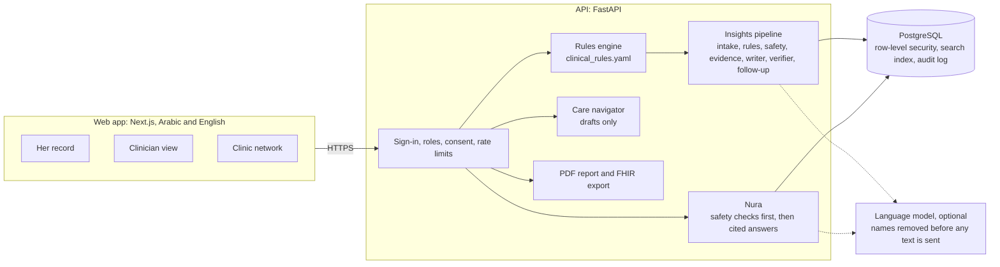

# ReproSense AI

**Understand your body. Recognise the patterns. Take informed action.**

ReproSense is a private health record for women in Abu Dhabi, in Arabic and English. A woman logs her cycle, symptoms,
blood pressure and lab results in a few seconds. Written rules taken from published medical guidelines turn those
months of entries into patterns worth discussing with a doctor, each one showing the exact days behind it and the
guideline it comes from. With her consent, her clinic receives a two-page report and tracks her follow-ups until they
are done. It never gives a diagnosis and never gives a risk percentage.

[](https://github.com/krish2105/ReproSense-AI-/actions/workflows/ci.yml)

Built for the **HealthX Ajyal Hackathon** (Department of Health, Abu Dhabi). Showcase: 22 November 2026, DOH Incubator,
Masdar City. Theme: Women's Health.

**Live demo:** https://reprosense.vercel.app (choose *Open the demo people*). The demo server sleeps when idle, so the
first page can take up to a minute to load.


> **Demo data only.** Every person, record and lab report in this repository is fictional and is generated by
> `data/synthetic/generate_synthetic.py`. Every screen carries a badge that says so.

---

## Contents

1. [The problem](#the-problem)
2. [The solution](#the-solution)
3. [What a woman, her doctor and her clinic each get](#what-a-woman-her-doctor-and-her-clinic-each-get)
4. [How it is different](#how-it-is-different)
5. [What the Department of Health gains](#what-the-department-of-health-gains)
6. [Safety by design](#safety-by-design)
7. [How it works](#how-it-works)
8. [Measured results](#measured-results)
9. [Who pays](#who-pays)
10. [Run it locally](#run-it-locally)
11. [Status, roadmap and limitations](#status-roadmap-and-limitations)
12. [Team and AI use](#team-and-ai-use)

---

## The problem

Picture a 24-year-old in Abu Dhabi. For a year her periods have come every six to eight weeks, and she has noticed
acne and new hair growth. Some of it is in her phone notes, some is in a photo of a blood test, and some she simply
remembers. When she finally sees a gynaecologist, she has about ten minutes to tell a year-long story, and she
forgets half of it.

The information exists. It reaches the doctor in pieces, so conditions are recognised late and follow-ups are missed.

| What the evidence shows | Source |
| --- | --- |
| Up to 70% of women with polycystic ovary syndrome (PCOS) do not know they have it. | [WHO, 2026](https://www.who.int/news-room/fact-sheets/detail/polycystic-ovary-syndrome) |
| In a UAE study of 518 women, endometriosis took 11.6 years on average from first symptoms to diagnosis. | [Frontiers in Global Women's Health, 2021](https://doi.org/10.3389/fgwh.2021.708410) |
| In Al Ain, 21.3% of 2,546 pregnancies had gestational diabetes, about 1 in 5. | [Frontiers in Endocrinology, 2022](https://doi.org/10.3389/fendo.2022.1069477) |
| At one Al Ain hospital, on 2013 to 2014 data, only 265 of 1,043 of those mothers came back for the glucose test within 4 to 6 weeks of the birth, about 1 in 4. | [IJERPH, 2022](https://doi.org/10.3390/ijerph192113946) |

That last follow-up matters to her later health: the American Diabetes Association recommends a glucose test 4 to 12
weeks after gestational diabetes. The Department of Health measured this follow-up as its primary-care indicator Jawda
PC008 until that indicator was retired in the 2025 update, so we do not present it as a current reporting duty. The
clinical recommendation stands. More evidence, with links, is in [docs/05](docs/05_EVIDENCE_AND_RESEARCH.md), and every
claim we make is listed with its source and limits in [docs/CLAIMS_REGISTER.md](docs/CLAIMS_REGISTER.md).

## The solution

ReproSense turns the pieces into one clear story that she and her doctor can act on.

1. **She logs in seconds.** A tap, a sentence spoken in Arabic or English, or a photo of a lab report. Nothing is
   saved until she has checked it.
2. **Rules find patterns.** Rules written from published guidelines read her entries and surface patterns worth
   discussing with a doctor. Each card shows what was noticed, the exact days behind it, what to consider next, and
   its source.
3. **Urgent signs come first.** Signs that need urgent care appear before anything else, with the UAE ambulance
   number 998. Signs of a mental health crisis open a support path instead of a card.
4. **Her doctor gets one page to read, not a year to reconstruct.** She can share a two-page report and a short
   "what changed since your last visit" brief with her clinic. She can stop sharing at any time.
5. **Follow-ups are tracked until they close.** For example, the glucose test after gestational diabetes stays on
   her home screen and on her clinic's worklist until it is booked and done.

The record follows her through five life stages: periods, trying to conceive, pregnancy, after birth, and
perimenopause. After a birth it also carries her baby's first-year checks and vaccinations.

## What a woman, her doctor and her clinic each get

| For | What they get |
| --- | --- |
| **Her** | A daily log for flow, pain, symptoms, mood and blood pressure. A cycle view, a 12-month timeline and simple analytics. Pattern cards with the evidence behind them. A box called "What we checked and did not show", which lists her own numbers next to each rule's threshold, so she can see why a card did or did not appear. |
| **Her, with Nura** | Nura is the built-in assistant. It answers from a library of cited guideline summaries, or from her own numbers worked out by code. It does not diagnose and does not advise on medicine doses, and it puts 998 first when a message sounds urgent. |
| **Her, before a visit** | A care navigator drafts her appointment request, her questions and a what-to-bring list. It only drafts. Nothing is sent or booked until she approves. |
| **Her doctor** | A two-page PDF report, a pre-visit brief, and an export in FHIR R4, the standard format that health record systems use. |
| **Her clinician** (with her consent) | A one-minute handover summary, the same evidence she sees, follow-ups that are due, and a way to ask questions that are answered only from her entries. |
| **The clinic network** | Follow-ups moving from due, to booked, to done, the after-birth glucose follow-up, timings for each step, a fairness check across groups, and a tamper-evident log of who opened what. Counts only, never names. |

Everything works in English and Arabic (right to left), in light and dark mode, on a phone or a laptop. It can be
installed from the browser like an app.

## How it is different

### Compared with period and women's health apps

Other products already do valuable parts of this, and we do not claim otherwise.

| Product | What it offers | Where ReproSense is different |
| --- | --- | --- |
| Flo, Clue | Cycle tracking and predictions. Flo also offers informational symptom checks, including for PCOS. | Each pattern shows her own dated entries and its guideline source, and goes to her clinic with consent. |
| Ovia | Support across life stages, sold to health plans, employers and health systems. | Built around one clinic workflow in Abu Dhabi, in Arabic and English. |
| Nabta Health | AI-supported women's healthcare delivered locally. | We are software a clinic adopts, not a care provider. A service like Nabta could use it. |
| A nurse's phone call, or a reminder in the clinic's own system | A prompt that a test is due. | The follow-up is tracked from due, to booked, to done, alongside her own history, and the clinic can see who is still open. |

Our intended specialty is narrow: what a woman observes and logs herself, connected to evidence, handed to her clinic
with her consent, and followed until the recommended care is completed. Whether that works better than the
alternatives is what a pilot has to show.

### Compared with general AI assistants such as ChatGPT, Claude and Gemini

General AI assistants are very good at explaining a topic. They are not a health record, and they are not built to be
safe by default for one woman's reproductive health over many months. ReproSense uses a language model too, but gives
it a much narrower job.

| | A general AI assistant | ReproSense |
| --- | --- | --- |
| What it knows about her | Only what she types into that chat | Her own record over months: cycles, symptoms, readings, lab results, life events |
| Who decides what is worth raising | The model, from its training | Written rules that a clinician can read, test and sign. The model never decides a pattern. |
| Evidence shown | A fluent answer, sometimes with links | The exact days from her record behind each statement, plus the guideline it comes from |
| Wrong or invented statements | Possible, and hard for her to spot | Answers come only from a curated library. A checker removes any sentence the sources do not support. If there is no source, it says so. |
| Diagnosis and percentages | May offer a likely condition or an estimate | Never names a condition as hers and never gives a probability |
| Urgent situations | Depends on how the question is phrased | Urgent signs are checked before anything else, in English and several Arabic dialects, and 998 stays on screen in every chat |
| What happens next | The conversation ends | A doctor-ready report, a consented share with her clinic, and a follow-up that stays open until it is done |
| Her data | Held by a global provider | Designed to stay in the UAE in production. She can turn AI off, export everything, or delete it. |

In short: an AI assistant answers a question. ReproSense keeps her record, shows its evidence, knows when something
cannot wait, and carries the result to her clinic.

### Compared with Sahatna and Malaffi, the Department of Health's own services

Sahatna is Abu Dhabi's front door to care: medical records, appointments, teleconsultations, prescriptions, wellness
tools and maternity care features, used by more than a million people. Malaffi, the health information exchange behind
it, gives clinicians AI summaries of the record and a patient wellness view. ReproSense does not replace either one.

What it adds is the part she writes herself between visits: her cycle, symptoms and readings, explained with their
guideline source, shared with her clinic by her choice, and a recommended follow-up tracked until it is done.

To be exact about integration: ReproSense exports in FHIR, the standard format. That is not a Malaffi integration.
A link to Malaffi or Sahatna would need a partnership with the Department of Health, which we do not have and do not
claim.

## What the Department of Health gains

A health department sees what happens inside clinics. ReproSense, with each woman's consent and as counts only, shows
what happens before she ever books.

| Benefit | What it means | Status |
| --- | --- | --- |
| Sight of the months between visits | How many women's entries match a pattern worth discussing, and how many of them have shared a report with a clinic, by region and age band. This shows where services and awareness are needed. | Built, on the network dashboard, with fictional data |
| Follow-up seen as it happens | After-birth follow-ups can be seen moving from due, to booked, to done, week by week. (The former indicator for this, PC008, was retired in 2025; the pilot clinic confirms which current measure applies.) | Built, with fictional data |
| Where follow-up is slow | Days from a follow-up opening to being booked, and postnatal steps completed inside their recommended window. | Built, with fictional data |
| Fairness evidence | Whether women in different age bands and nationality groups are flagged and followed up at similar rates. | Built, with fictional data |
| A working example of responsible AI | Rules that explain themselves, human approval before any action, an AI off switch, and an access log she can read. These match what the Department's Responsible AI Standard asks for. | Built |
| Local research | A consented, anonymised cohort of women in Abu Dhabi. Most published evidence comes from other populations. | Roadmap. Research consent is already a separate choice in the record. |
| Health messaging | Counts of the topics women ask Nura about, to guide public awareness campaigns. | Roadmap |
| Screening uptake | Reminders for the Department's cervical and breast screening programmes, tracked like any other follow-up. | Roadmap |

What this is not: a register, a list of names, or a count of diagnoses. A pattern is a rule match on a woman's own
entries, and only a doctor can assess it. Groups of fewer than 10 women are hidden, including any part that could be
worked out by subtraction.

## Safety by design

These rules are enforced in code and in tests, not only written down ([CLAUDE.md](CLAUDE.md)).

1. **It never diagnoses.** Patterns come only from the transparent rules in
   [`rules/clinical_rules.yaml`](rules/clinical_rules.yaml): 7 urgent red-flag rules and 13 pattern and follow-up
   rules, each with its source. An output guard blocks diagnostic wording in English and Arabic.
2. **Urgent signs come first.** Red-flag rules run before anything else and show 998 guidance. A worrying answer to
   the self-harm question in the mood check opens a support path with 998 and the Department of Health's 24-hour line
   800-SAKINA, never a score.
3. **Every answer has a source.** Nura answers from [`knowledge_base/sources.yaml`](knowledge_base/sources.yaml)
   (52 sources, each summarised in our own words with a link to the original). If nothing in the library answers
   the question, it says so.
4. **Agents ask first.** The care navigator only drafts. She approves before anything leaves her record.
5. **Acne alone is never treated as a sign of PCOS.** The rule needs irregular cycles first, as the 2023
   international PCOS guideline describes, and the app shows her the numbers behind that decision.
6. **Privacy is built into the database.** Row-level security means one woman's rows cannot be read from another
   account. Clinicians see only women who chose to share with their clinic. Free-text notes are encrypted. Every
   access is written to a tamper-evident log she can read. When she turns AI off, nothing about her is sent to a model.

The safety case, hazard log and rule sign-off sheet are in [docs/safety](docs/safety).

## How it works



The design choices that matter ([docs/02](docs/02_ARCHITECTURE.md), [docs/03](docs/03_AI_PIPELINE.md)):

- **Rules decide the patterns. The model does language work, and each part is checked.** The model turns her spoken
  sentence or a lab photo into fields that she confirms before anything is saved, rewords text, and gives a second
  safety classification of chat messages. The rules step that decides patterns uses no AI. A verifier removes any
  sentence the facts do not support. With no model configured the app
  still works in full, using fixed wording, so the demo never depends on an AI key.
- **Safety checks look for combinations of ideas,** such as heavy bleeding together with fainting, in English and in
  Gulf, Egyptian, Levantine and standard Arabic. When a model is configured, it gives a second opinion that can add
  an urgent route but can never remove one.
- **Search that works in both languages.** Answers are found with word search and similarity search together, inside
  the same database. An Arabic question can find an English source and is answered in Arabic.
- **No lock-in to one AI provider.** The hackathon demo calls a commercial model on fictional data only. Production
  would use a model hosted in the UAE, with no change to the code that calls it.

**Stack:** Next.js 16, TypeScript and Tailwind on the web. Python 3.12, FastAPI and Pydantic on the server.
PostgreSQL with pgvector. LangGraph for the agent pipelines. WeasyPrint for the PDF. An iOS app shares the same record
(`apps/mobile`).

## Measured results

All numbers come from files in this repository and are produced by the test suite. They are also shown on the live
site at `/status` and `/evidence`.

**Nura's test set:** 60 questions written by the team, 30 in English and 30 in Arabic.

| Check | Result |
| --- | --- |
| Answers grounded in a cited source | 30 of 30 |
| Requests for a diagnosis or a probability politely refused | 15 of 15 |
| Urgent messages sent to urgent guidance | 15 of 15 |
| Banned diagnostic phrases in any answer | 0 |
| Answer given in the language of the question | 60 of 60 |

**Held-out safety test:** 132 messages written by reviewers who never saw the code, in English and four kinds of
Arabic. It was measured once and is never used to tune the checks.

| Expected handling | Word checks alone | With the model's second check |
| --- | --- | --- |
| Crisis message sent to support | 11 of 30 | **30 of 30** |
| Emergency sent to 998 guidance | 24 of 32 | **32 of 32** |
| Everyday question answered normally | 42 of 50 | 42 of 50 |
| Diagnosis request given the exact refusal | 6 of 10 | 6 of 10 |
| Medicine question given the exact refusal | 4 of 10 | 4 of 10 |

The misses in the last two rows still received a sourced answer with no diagnosis and no dose. Tightening those
refusals is next. Whatever the checks find, the 998 button stays visible in every chat.

**Automated tests on every change**

| Suite | Size |
| --- | --- |
| Server tests: rules, API, privacy, safety checks, Nura, PDF, FHIR, security | About 900 |
| Web unit tests | 29 files |
| Browser tests on desktop and phone: the demo path, every screen, safety, Arabic layout, accessibility | 39 test files |
| Security attack suite | 14 of 14 attacks blocked |

Every pull request also runs lint, type checks, a build, a secret scan and a check that the fictional data generator
produces identical output for its seed.

## Who pays

Women use ReproSense free, always. There is no advertising and health data is never sold.

Clinics and primary-care networks would pay a subscription, because follow-ups that guidelines recommend get done and
they can see it. Insurers could later pay per follow-up closed. There is no price yet, on purpose: it will be set with
the first pilot clinic, from what the pilot measures. The live site has a page where a clinic can enter its own
numbers and see how many more follow-ups would close ([/pilot](https://reprosense.vercel.app/pilot)). The pilot
proposal is in [docs/29](docs/29_PILOT_PROPOSAL_AND_LOI.md).

## Run it locally

You need Python 3.12 with [uv](https://docs.astral.sh/uv/), Node with pnpm, and PostgreSQL 17 with pgvector. On macOS
the PDF library also needs Pango from Homebrew.

```bash
make env db seed     # local .env with random keys, databases, schema, fictional data and the search index
make api             # API on http://localhost:8010
```

```bash
cd apps/web && pnpm install && pnpm dev    # web app on http://localhost:3000
```

Open http://localhost:3000, choose **Open the demo people**, and pick one. For example: Noura (irregular cycles),
Sara (heavy bleeding, the urgent example), Hessa (pregnancy) or Fatima (after birth). No AI key is needed. To turn on
the language model, set `LLM_PROVIDER` and the matching key named in [`.env.example`](.env.example). Use fictional
data only. Secrets live only in `.env`, which is never committed.

```bash
make test                                                 # server lint and tests
cd apps/web && pnpm lint && pnpm test                     # web lint and unit tests
cd apps/web && pnpm build && PW_CHANNEL=chrome pnpm e2e   # browser tests
make safety-eval                                          # the held-out safety test
```

Deployment is described step by step in [docs/16_DEPLOY_NOW.md](docs/16_DEPLOY_NOW.md).

### Repository map

| Path | What it is |
| --- | --- |
| `apps/web/` | The web app: landing page, demo, her record, clinician and clinic-network screens, status and trust pages |
| `apps/mobile/` | The iOS app on the same record |
| `backend/app/` | The server: `api/`, `agents/` (pipeline, Nura, safety, navigator), `rules/`, `rag/`, `reports/`, `security/`, `services/` |
| `rules/` | `clinical_rules.yaml`, the only place pattern logic lives, and its Arabic wording |
| `knowledge_base/` | The curated sources and our own summaries in English and Arabic |
| `data/synthetic/` | The fictional data generator and its output: nine demo women, a 1,200-woman network, lab reports |
| `docs/` | Product, architecture, AI pipeline, evidence, security, safety case, pitch, pilot proposal, Arabic review sheet |

## Status, roadmap and limitations

**Where it stands (22 November 2026).** The product is live and working end to end on fictional data: her record
across five life stages, Nura, the doctor report, the clinician view, the clinic network dashboard, and the safety
results above.

**Next six months**

- A clinical advisor reviews and signs the rules.
- Interviews with women and clinicians, and a letter of intent from one clinic.
- A move to UAE hosting with UAE PASS sign-in, and a security test.
- A consented pilot with one clinic, measured on one number: how many mothers with gestational diabetes complete
  their glucose test after birth.
- Later: a link to Malaffi through the proper Department of Health route, screening reminders, and asking once about
  contraception, medicines and thyroid conditions so that cards can take them into account.

**Limitations, stated plainly**

- **No real users yet.** Everything runs on fictional data, by design. No real patient data has been used.
- **No clinician has signed the rules yet.** They follow published guidelines and each one cites its source, but
  clinical sign-off is the team's first ask.
- **Regulatory status is not decided.** The product is designed to inform a conversation with a doctor, not to
  diagnose. Classification is a decision for the Emirates Drug Establishment.
- **The Arabic is a careful draft.** It has not yet had a full review by a native speaker
  ([docs/AR_REVIEW.md](docs/AR_REVIEW.md)).
- **The app only knows what she logs.** It says so on screen, and it never says that nothing is wrong.
- **Demo hosting is temporary.** The demo runs on free servers in Frankfurt with fictional data. UAE law requires
  real health data to stay in the UAE, and the production design does that.

## Team and AI use

| Member | Role |
| --- | --- |
| **Krishna Mathur** | AI, server and clinical safety |
| **Atharva Soundankar** | Web app, design and data views |
| **Yash Petkar** | Product, demo and submission |
| **Zebo** | Women's health evidence |

A clinical advisor is being recruited.

**AI use, disclosed as the hackathon requires.** Claude (Anthropic) assisted with research, specification and code.
ChatGPT generated the illustrations. AI use is also disclosed in the app footer and in the pitch. Guideline content
is summarised in our own words, with links to the original sources (NHS, NICE, WHO, ESHRE, ACOG, the Department of
Health and others).

ReproSense gives information, not a diagnosis. In an emergency in the UAE, call 998.

No open-source licence has been chosen yet. All rights are reserved by the team.
