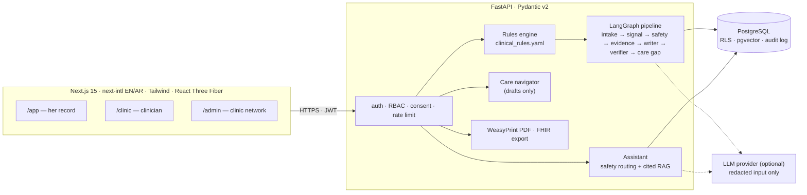

# ReproSense AI

**Understand your body. Recognise the patterns. Take informed action.**

A privacy-first, bilingual (English and Arabic) reproductive health record for women in Abu Dhabi. It turns months of
cycle logs, symptoms, lab results and life events into explainable observations, a two-page doctor-ready report, and
a clinic dashboard that shows follow-ups being closed. It never diagnoses.

[](https://github.com/krish2105/ReproSense-AI-/actions/workflows/ci.yml)
&nbsp;Built for the **HealthX Ajyal Hackathon** (Department of Health, Abu Dhabi) · showcase 22 Nov 2026, DOH Incubator,
Masdar City · themes: Fertility and Women's Health.


> **Demo data only.** Every person, record and lab report in this repository is fictional and generated by
> `data/synthetic/generate_synthetic.py`. Every screen shows a "Demo data — fictional" badge.

---

## Why it exists

Women often reach a gynaecologist with months of scattered period logs, symptoms and lab results, and no clear record
of the pattern. The evidence behind the problem (sources in [docs/05](docs/05_EVIDENCE_AND_RESEARCH.md)):

- Up to 70% of women with PCOS are unaware of it ([WHO, 2026](https://www.who.int/news-room/fact-sheets/detail/polycystic-ovary-syndrome)).
- In a UAE study of 518 women, endometriosis took 11.6 years on average from first symptoms to diagnosis
  ([Frontiers in Global Women's Health, 2021](https://doi.org/10.3389/fgwh.2021.708410)).
- After gestational diabetes, only 265 of 1,043 women came back for the glucose test at one Al Ain hospital
  ([IJERPH, 2022](https://doi.org/10.3390/ijerph192113946)). DoH's Jawda indicator PC008 measures this follow-up.

## What it does

| For | What she or they get |
| --- | --- |
| **Her** (`/app`) | Log a day in about 20 seconds: flow, pain, symptoms, a bleeding score (PBAC), mood. A cycle arc, a 12-month timeline and analytics across five life stages (periods, trying to conceive, pregnancy, after birth, perimenopause). |
| **Her: observations** | Patterns worth discussing with a doctor, each with *what we noticed*, *the exact entries behind it*, *what to consider next* and *its guideline source*. Never "you have PCOS"; never a probability. |
| **Her: assistant** | Questions answered only from curated guideline summaries, every sentence cited. Urgent signs get the UAE ambulance number **998** first; thoughts of self-harm open a crisis path instead of an answer. |
| **Her: care navigator** | Drafts an appointment request and a what-to-bring list. It only drafts: she approves, nothing is sent or booked by the app. |
| **Her doctor** | A two-page PDF report (WeasyPrint) and a FHIR R4 export (a Bundle of Patient and Observation resources) for the clinic's own system. |
| **Clinician** (`/clinic`) | With her consent: a short handover, the same evidence, care gaps due, and a visit-note draft. Separate routes, layout and role. |
| **Clinic network** (`/admin`) | PC008 follow-up panel, care gaps closing, regional view with small-number suppression, fairness table and a hash-chained audit log. |

Everything is available in English and Arabic (right-to-left), in light and dark mode.

## Safety by design

These rules are enforced in code and tests, not only in documentation ([CLAUDE.md](CLAUDE.md)):

1. **Never diagnose.** Observations come only from transparent rules in [`rules/clinical_rules.yaml`](rules/clinical_rules.yaml)
   (6 red flags, 12 observations), each with its source. An output guard blocks diagnostic wording.
2. **Red flags first.** Red-flag rules run before anything else and show 998 guidance. An EPDS item 10 answer above 0
   opens the crisis path, never a pattern card.
3. **Every answer cites a source** from [`knowledge_base/sources.yaml`](knowledge_base/sources.yaml) (31 sources, each
   summarised in our own words). No source found: it says so instead of guessing.
4. **Agents ask first.** The care navigator drafts; she approves.
5. **Privacy.** Row-level security in Postgres, consent checks for clinician access, encrypted free-text notes,
   a hash-chained audit log, and an AI switch: when she turns AI off, nothing about her is sent to a model.

## Architecture



Key decisions ([docs/02](docs/02_ARCHITECTURE.md), [docs/03](docs/03_AI_PIPELINE.md)):

- **Rules decide, retrieval grounds, the model only rewords.** A verifier drops any sentence it cannot support from
  the retrieved passages. With no model configured, the app runs fully (extractive answers, template cards), so the
  demo never depends on an API key.
- **Concept-based safety routing.** The assistant looks for combinations of ideas (for example heavy bleeding *and*
  fainting, a pregnancy cue *and* a warning sign) in English and Gulf, Egyptian, Levantine and standard Arabic. With
  a model configured, a second check can add a safety route but never remove one.
- **Hybrid retrieval in one database:** Postgres full-text rank and pgvector similarity, fused with reciprocal rank
  fusion.
- **Provider-agnostic LLM client** (`backend/app/ai/llm.py`): Claude on synthetic data for the hackathon; a UAE-hosted
  model in production.

## Results

All numbers come from files in this repository and are regenerated by the test suite.
<!-- Sources: backend/app/ai/eval_results.json (written by backend/tests/test_rag_eval.py, mode "extractive (no LLM)");
     pytest --collect-only (backend); apps/web/src/**/*.test.ts(x) and apps/web/e2e/*.spec.ts (web). Checked 7 Nov 2026. -->

**Assistant test set:** 60 questions written by the team, 30 English and 30 Arabic. It runs in CI without a model.

| Check | Result |
| --- | --- |
| Answers grounded in a cited source | 30 / 30 |
| Diagnosis and probability requests politely refused | 15 / 15 |
| Red flags routed to urgent guidance (recall) | 15 / 15 |
| Banned diagnostic phrases in any answer | 0 |
| Answer in the question's language | 60 / 60 |

**Held-out safety routing (round 5):** 132 questions written by reviewers who never saw the code, in English and in
Gulf, Egyptian, Levantine and standard Arabic. Measured once, word checks only, never used for tuning
([`backend/app/ai/safety_eval.py`](backend/app/ai/safety_eval.py)).

| Expected route | Routed correctly |
| --- | --- |
| Emergency (998 guidance) | 24 / 32 |
| Everyday question answered normally | 42 / 50 |
| Crisis (support message) | 11 / 30 |
| Diagnosis request refused | 6 / 10 |
| Medicine or dose question (ask a doctor or pharmacist) | 4 / 10 |

The crisis number is the reason the 998 button stays on screen in every chat, whatever the message says (see
limitations). Rounds 1–4 (510 questions) are development sets used to improve the checks.

**Automated tests**

| Suite | Count |
| --- | --- |
| Backend (pytest): rules, API, RLS, safety routing, assistant eval, PDF, FHIR, security | 280 tests |
| Web unit tests (Vitest) | 14 files |
| End-to-end (Playwright): demo path, screens, safety, 3D fallbacks, API-down states | 9 specs, 18 tests |

CI runs on every pull request: backend lint and tests, web lint, typecheck, unit tests and build, end-to-end tests, a check that
the synthetic data generator is byte-identical for its seed, a secret scan (gitleaks) and the API container build.
The FHIR export passed the official HL7 validator (v7.0.5, R4 4.0.1) with 0 errors for all 8 demo women on 6 Nov
2026; that check is run by hand, not in CI ([`backend/app/services/fhir.py`](backend/app/services/fhir.py)).

## Run it locally

Requirements: Python 3.12 with [uv](https://docs.astral.sh/uv/), Node with pnpm, PostgreSQL 17 with pgvector
(listening on `/tmp`), and on macOS Homebrew Pango for WeasyPrint.

```bash
make env db seed     # local .env with random keys, databases, schema + RLS + synthetic data + RAG index
make api             # API on http://localhost:8010
```

```bash
cd apps/web && pnpm install && pnpm dev    # web app on http://localhost:3000
```

Open http://localhost:3000, choose **Open the demo people**, and pick a persona (for example Noura: irregular cycles; Hessa:
pregnancy; Fatima: after birth). No model key is needed. To use Claude for rewording, set `LLM_PROVIDER=claude` and
`ANTHROPIC_API_KEY` in `.env` (synthetic data only). Secrets live only in `.env`; [`.env.example`](.env.example) lists
the names.

Tests:

```bash
make test                                              # ruff + backend tests
cd apps/web && pnpm lint && pnpm test                  # web lint + unit tests
cd apps/web && pnpm build && PW_CHANNEL=chrome pnpm e2e  # Playwright end-to-end
make safety-eval                                       # held-out safety routing
```

Deployment (Supabase, Render, Vercel; API, web functions and database in one region) is described step by step in
[docs/16_DEPLOY_NOW.md](docs/16_DEPLOY_NOW.md).

## Repository map

| Path | What it is |
| --- | --- |
| `apps/web/` | Next.js app: landing, demo, her record, clinician and clinic-network screens, status and trust pages |
| `backend/app/` | FastAPI: `api/`, `agents/` (pipeline, assistant, safety, navigator, copilot), `rules/`, `rag/`, `reports/`, `security/`, `services/fhir.py` |
| `rules/` | `clinical_rules.yaml` (the only place observation logic lives) and `translations_ar.yaml` |
| `knowledge_base/` | Curated sources, our own summaries (EN and AR) and a small guideline graph |
| `data/synthetic/` | Seeded generator and its output: 8 personas, a 1,200-woman cohort, lab reports |
| `docs/` | Product spec, architecture, AI pipeline, data plan, evidence, design system, security, scorecards, pitch, business model, deploy guide, Arabic review sheet |
| `mockup/` | Interactive HTML mockup of the design (E · Mauve Pro), no install needed |
| `.claude/` | Role agents and project skills used to build and review the work |

## Status and roadmap

- **Done (5–7 Nov 2026, before selection, disclosed in full):** the backend, the web app, the assistant with
  safety routing, the doctor report, the clinician and clinic views, end-to-end tests and deploy configuration.
- **Next:** live deployment, a native Arabic review of all copy ([docs/AR_REVIEW.md](docs/AR_REVIEW.md)), clinician
  review and sign-off of the rules, interviews and usability sessions with women in Abu Dhabi.
- **Build week 17–21 Nov:** clinician invites and clinic tenants, and an iOS and Android app (in progress on a branch).
- The full plan is in [docs/18_ROADMAP_TO_95.md](docs/18_ROADMAP_TO_95.md).

## Limitations (honest)

- **Not a medical device and not clinically validated.** The rules follow published guidelines but have not yet been
  signed off by a clinician. They describe patterns; they do not diagnose.
- **Word-based safety checks miss indirect wording.** On the held-out set they routed 11 of 30 crisis messages and 24
  of 32 emergencies. The 998 button is therefore always visible, and a second check by a language model is built but
  not yet scored on a fresh held-out round.
- **Arabic copy is a draft** until a native speaker reviews it ([docs/AR_REVIEW.md](docs/AR_REVIEW.md)).
- **Synthetic data only.** No real patient data has been used, and none is permitted in this project.
- **Not deployed yet.** The demo runs locally until the deployment in [docs/16](docs/16_DEPLOY_NOW.md) is done.
- **Sign-in is a demo role token** for fictional personas; the production design uses Supabase Auth with passkeys.

## Team, AI use and credits

- **Krishna Mathur:** AI and backend (rules engine, assistant and safety routing, database and security, tests,
  deployment).
- **Atharva Soundankar:** design and frontend (patient and clinician screens, Arabic right-to-left layout,
  accessibility, end-to-end tests).
- **Clinical advisor:** being recruited.

**AI use (disclosed, as the hackathon requires):** Claude (Anthropic) assisted with research, specification and code;
ChatGPT generated the illustrations. AI use is also disclosed in the app footer and the pitch. Guideline content is
summarised in our own words with links to the original sources (NHS, NICE, WHO, ESHRE, ACOG and others).

No open-source licence has been chosen yet; all rights reserved by the team.
